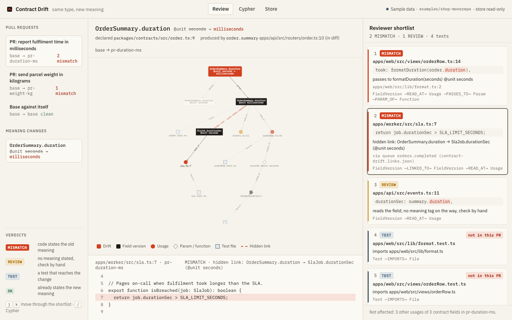
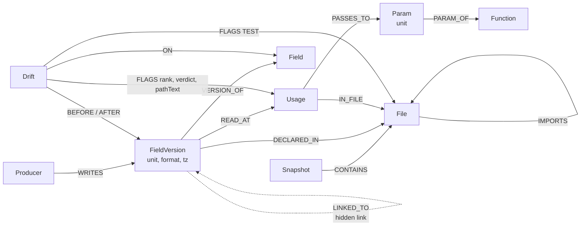
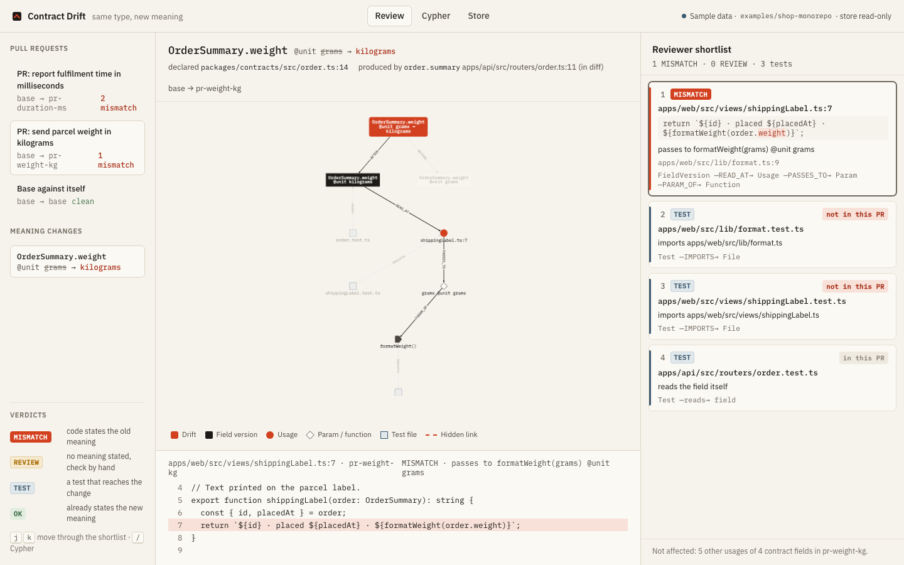
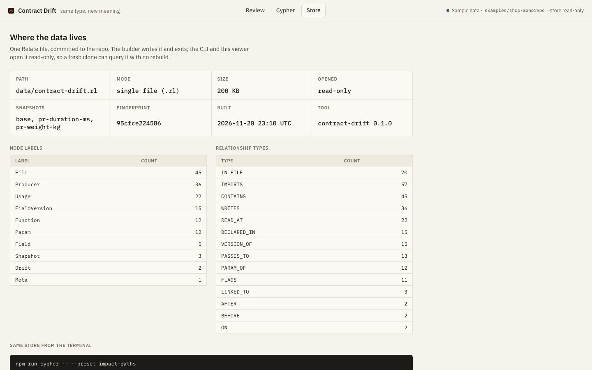

# Contract Drift

Catch the PR that passes TypeScript but changes what an API field means.



## Use case

A reviewer approves a PR that changes `OrderSummary.duration` from seconds to milliseconds. It is still a
`number`, so the type check is green. But a web formatter still assumes seconds, and a background worker
that gets the value through a queue alerts on it as seconds. Grep finds hundreds of `duration`s.

Contract Drift reads explicit meaning tags (`@unit`, `@format`, `@tz`) on shared contract fields, loads the
base and head snapshots of the monorepo into one Relate graph, finds the meaning change with a Cypher query,
and gives the reviewer a ranked **shortlist**: every usage and test the change reaches, with file:line
evidence and the impact path, including tests the PR never touched. It stays quiet for unrelated changes.

What it does not do: guess meaning (only explicit tags, see `docs/adr/0002-explicit-meaning-tags-only.md`),
read git, call an LLM, or need any account or key.

## How it uses Relate

- **Mode:** single file. The store is `data/contract-drift.rl`, committed to the repo.
- **Why this mode:** a copied `.rl` file opens in a fresh process with no side files or lock files, so a
  judge can clone and query it immediately with no rebuild. Relate allows one writer per store and has no
  `close()`, so the design is: `build:graph` is the only writer, it writes and exits; the CLI and the viewer
  open the file read-only. The `.rl` bytes are not deterministic between builds, so the build stores a
  content fingerprint in a `:Meta` node and skips the rebuild when nothing changed (a judge running the
  demo leaves `git status` clean). See `docs/adr/0001-single-file-relate-store.md`.
- **What the graph models:** both snapshots of the same monorepo live side by side in one graph, and the
  diff happens in the graph (`docs/adr/0003-diff-in-the-graph.md`).



The three queries the tool runs live in `queries/` and are loaded by the code verbatim:

`queries/drift.cypher`: a meaning change is the same `Field` with a different tag in two snapshots.

```cypher
MATCH (f:Field)<-[:VERSION_OF]-(b:FieldVersion {snapshot: $base})
MATCH (f)<-[:VERSION_OF]-(h:FieldVersion {snapshot: $head})
UNWIND ['unit', 'format', 'tz'] AS tag
WITH f, b, h, tag, b[tag] AS before, h[tag] AS after
WHERE before IS NOT NULL AND after IS NOT NULL AND before <> after
RETURN f.key AS key, tag, before, after, b.id AS baseId, h.id AS headId
```

`queries/impact.cypher`: variable-length reach through hidden links (`LINKED_TO*0..2`) to every read,
plus the tagged parameter the value flows into.

```cypher
MATCH (h:FieldVersion {id: $headId})
MATCH p = (h)-[:LINKED_TO*0..2]->(lv:FieldVersion)-[:READ_AT]->(u:Usage)
WHERE u.inTest = false
OPTIONAL MATCH (u)-[:PASSES_TO]->(pm:Param)-[:PARAM_OF]->(fn:Function)
RETURN u.id AS usageId, ..., lv[$tag] AS viaTag, pm[$tag] AS paramTag, length(p) AS hops,
       [r IN relationships(p) | type(r)] AS rels
```

`queries/tests.cypher`: tests that import (up to 3 hops) a file with a flagged usage.

```cypher
MATCH (d:Drift {id: $driftId})-[:FLAGS]->(u:Usage)
MATCH (u)-[:IN_FILE|PASSES_TO|PARAM_OF*1..3]->(target:File)
MATCH tp = (t:File {snapshot: $head, isTest: true})-[:IMPORTS*1..3]->(target)
...
RETURN t.path AS path, t.inDiff AS inDiff, hops, reaches
```

Findings are written back to the store as `(:Drift)-[:FLAGS {rank, verdict, reason, hops, pathText}]->`,
so the CLI, the viewer and any ad-hoc Cypher all read the same persisted answer.

Verdicts: **MISMATCH** when the value reaches a parameter or linked field tagged with a different meaning
than the new one; **REVIEW** when nothing on the path states a meaning; **OK** when it already states the
new meaning; **TEST** for tests that reach a flagged usage. `in diff` is computed in Cypher by comparing
file hashes across the two snapshots.

## Setup and run

Requires Node 22. Nothing else: no database server, no keys, no network at runtime.

```bash
git clone https://github.com/RealCloudyPanda/Neo4j-Hackathon.git
cd Neo4j-Hackathon
npm install
npm run demo          # build:graph (no-op on a fresh clone) → analyze → viewer on http://localhost:4317
```

Individual commands:

```bash
npm run analyze                              # base → pr-duration-ms, exit code 1 (MISMATCH found)
npm run analyze -- --head pr-weight-kg       # negative case: the worker is not listed
npm run analyze -- --head base               # "No meaning changes", exit code 0
npm run analyze -- --markdown                # PR-comment table; also --json, --show-cypher, --no-color
npm run cypher -- --preset tests-not-in-diff # read-only Cypher; --list-presets for all
npm run cypher -- "MATCH (d:Drift)-[r:FLAGS]->(x) RETURN d.key, r.verdict, x.path"
npm run viewer                               # http://localhost:4317 (stop it before rebuilding)
npm run build:graph -- --force               # rebuild data/contract-drift.rl from the fixture
npm test                                     # 16 tests: extraction, load, positive, negative, no-drift, fixture tsc
npx contract-drift analyze --base ./old-checkout --head ./new-checkout   # any two folders, in-memory store
```

Real output of `npm run analyze` (copied from a run on this repo):

```
Contract Drift  base → pr-duration-ms        store data/contract-drift.rl (read-only)

DRIFT  OrderSummary.duration   @unit seconds → milliseconds
       declared   packages/contracts/src/order.ts:9
       produced   order.summary  apps/api/src/routers/order.ts:10   (in diff)

Reviewer shortlist                                                   in diff
   1  MISMATCH  apps/web/src/views/orderRow.ts:14                    no
                took: formatDuration(order.duration),
                passes to formatDuration(seconds) @unit seconds
                apps/web/src/lib/format.ts:2
                path  FieldVersion ─READ_AT→ Usage ─PASSES_TO→ Param ─PARAM_OF→ Function
   2  MISMATCH  apps/worker/src/sla.ts:7                             no
                return job.durationSec > SLA_LIMIT_SECONDS;
                hidden link: OrderSummary.duration → SlaJob.durationSec (@unit seconds)
                via queue orders.completed (contract-drift.links.json)
                path  FieldVersion ─LINKED_TO→ FieldVersion ─READ_AT→ Usage
   3  REVIEW    apps/api/src/events.ts:11                            no
                durationSec: summary.duration,
                reads the field; no meaning tag on the way, check by hand
                path  FieldVersion ─READ_AT→ Usage
   4  TEST      apps/web/src/lib/format.test.ts                      no   ← not in this PR
                imports apps/web/src/lib/format.ts
   5  TEST      apps/web/src/views/orderRow.test.ts                  no   ← not in this PR
                imports apps/web/src/views/orderRow.ts
   6  TEST      apps/worker/src/sla.test.ts                          no   ← not in this PR
                imports apps/worker/src/sla.ts
   7  TEST      apps/api/src/routers/order.test.ts                   yes
                reads the field itself

Not affected: 3 other usages of 3 contract fields.   2 MISMATCH · 1 REVIEW · 4 tests
```

The unrelated PR (`--head pr-weight-kg`) flags `apps/web/src/views/shippingLabel.ts` as MISMATCH and
nothing under `apps/worker/`:



The Store tab shows where the data lives, the label and relationship counts read from the `.rl` file, and
the build fingerprint:



The viewer also has a read-only **Cypher** tab with preset queries (Drifts, Impact paths, Tests not in diff,
Hidden links, Whole head graph), results as a table or a graph.

## Where the data lives

| What | Where |
| --- | --- |
| Relate store (single file, committed) | `data/contract-drift.rl` |
| Queries the tool runs | `queries/drift.cypher`, `queries/impact.cypher`, `queries/tests.cypher`, `queries/tests-direct.cypher` |
| Preset queries (CLI and viewer) | `queries/presets/*.cypher` |
| Sample monorepo: base and two PR snapshots | `examples/shop-monorepo/snapshots/` |
| Hidden links (queue between services) | `examples/shop-monorepo/snapshots/*/contract-drift.links.json` |

**Sample data:** everything shown comes from the fixture monorepo in `examples/shop-monorepo` (a tRPC-shaped
API, a web app and a worker; all three snapshots pass `tsc --noEmit`). There is no live mode with keys:
to run on your own code, pass two folders (`--base ./a --head ./b`).

## Judging criteria → where to see proof

| Criterion | Proof |
| --- | --- |
| Relate & connected context | Committed `data/contract-drift.rl`; drift found by Cypher across two snapshots in one graph; impact via variable-length paths mixing code edges and hidden links; findings persisted as `FLAGS`; `queries/*.cypher`; read-only Cypher console and `npm run cypher` |
| Functionality & completeness | `npm run demo`; CLI with text / JSON / Markdown and exit codes; viewer with Review, Cypher and Store tabs; `npm test` (16 passing) |
| Usefulness | A failure TypeScript cannot catch; the shortlist names `sla.test.ts`, a test outside the diff; silent on the unrelated weight PR; `--markdown` for PR comments; works on any two folders |
| Documentation & reproducibility | This README, verified from a fresh clone; `docs/SPEC.md`, `docs/adr/`, `GLOSSARY.md`, `docs/RESEARCH.md` |
| Creativity | "Same type, new meaning": a graph of meaning, not of imports |

## Project structure

```
src/relate/store.ts   the only module touching @relate/relate: one handle per path, read-only for readers
src/extract/          ts-morph: files, imports, tagged fields, producers, usages, parameter flow, link manifest
src/graph/            constraints, UNWIND batch loading, build with fingerprint skip
src/review/           drift, impact + verdicts, ranking, tests, saving and reading FLAGS
src/cli/              analyze, build, cypher, demo, text / JSON / Markdown formatters
src/viewer/           Express server (read-only store) and the static UI (Cytoscape)
queries/              Cypher run by the tool, plus presets
examples/             fixture monorepo
test/                 node:test suites (in-memory Relate stores)
```

## Known limitations

- Meaning comes only from explicit `@unit` / `@format` / `@tz` tags. Untagged fields are ignored; an
  untagged read is shown as REVIEW, never guessed.
- Value flow is followed one step: a read that is a direct argument of a call reaches that parameter.
  Values stored in a variable first are reported as REVIEW.
- Hidden links must be declared in `contract-drift.links.json`.
- Only `@unit` changes are in the fixture; `@format` and `@tz` use the same code path but have no fixture case.
- Not done in this build (time): a CLI output snapshot test, an end-to-end test that opens the committed
  store in a child process, a viewer screenshot of the Cypher tab, a GitHub Action example, and reading two
  git refs directly (`--since`).
- The viewer must be stopped before `npm run build:graph -- --force`: Relate allows no reader while the
  writer holds the store.
- The `relate` CLI command shown in the Store tab is optional and was not part of the tested path.

## How this was built

Planned and built with AI coding assistants under the author's direction (spec, plan, code and docs were
drafted with AI help and reviewed by running them). The product itself uses no AI; every finding comes from
the graph. All output shown in this README comes from real runs.

## License

MIT, see `LICENSE`.
